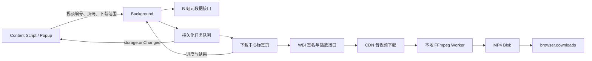

# B 站下载器：实现方案

本文记录最初的 MP4 下载架构。后续的分 P 自选、画质上限、暂停、P1 素材导出 / 文件设置、P2 批量来源 / 下载缓存 / 本地助手、P3 会话恢复 / 长期历史 / 单任务控制、P4 原生助手集成及 P5 素材组合，详见 [扩展路线图](roadmap.md) 和 [使用说明](usage.md)。P1 新增弹幕主机 `comment.bilibili.com` 的访问及 Referer 规则，并启用既有可选通知权限的用户开关；P4 新增按需申请的可选 `nativeMessaging` 权限。下文仅列初版权限与视频流程，后续契约以路线图为准。

本实现基于讨论中的「默认最高可用画质、音视频合并 MP4」方案，沿用项目已有的 WXT、Vue 3、TypeScript、UnoCSS 和 Manifest V3。新增代码可以直接构建为扩展，不依赖本地下载服务。

## 2026-10-04 能力扩展

本轮计划见 [扩展路线图](roadmap.md)。在以下基础架构上增加：

- 自选分 P：`DownloadPartPicker` 提供当前 / 全部 / 自选范围，后台校验页码并按元数据顺序入队。
- 画质偏好：`DownloadQuality` 与 `useDownloadSettings` 持久化默认值；`DownloadJob.qualityPreference` 保存任务快照，旧任务默认 `best`。请求 qn 随偏好变化，DASH 按短边分辨率过滤上限，progressive 按明确画质档位校验，未知或高于上限时失败。
- 队列暂停：`storage.local.downloadSettings.isPaused` 控制后台 `runner.claim`。当前任务继续执行，恢复后才领取下一项；仍不支持下载途中断点暂停。
- 队列整理：搜索标题、BV 和分 P；筛选失败；批量重试失败并去重，取消任务仅单独重试。重试清除旧执行状态和实际画质，但保留提交偏好。

设置与队列修改共用后台锁，设置更新只合并提供的字段，避免暂停操作重置画质。各界面订阅 storage 变化；任务偏好不随默认设置变化。无新增权限或依赖。

## 交互与视觉

- 单视频：展示视频信息与「下载视频」按钮，点击后直接加入队列。
- 多 P：默认「当前分 P」，切换到「全部分 P」后按视频信息接口返回的顺序下载；每个分 P 保存独立 MP4，不拼接成一个长视频。
- 页面 URL 的 `p` 决定当前分 P；切换 BV / av 或分 P 后重新获取元数据，旧请求的结果不会覆盖新页面。
- 下载中心展示等待、解析、下载、合并、保存、完成、失败、取消状态，支持取消、批量取消、失败重试、清除记录和打开文件夹。
- 下载目录是浏览器默认下载目录下的 `Bilibili/`，重名文件由浏览器自动增加后缀。

视觉使用 `#FB7299` 主粉色、`#FFF1F5` 浅粉、`#BF3D66` 深粉文字、`#18191C` 主文字、`#70747C` 次要文字和 `#F7F8FA` 页面底色。中文字体优先 PingFang SC / Microsoft YaHei，主内容左对齐，主要操作使用整行粉色按钮。深色按钮文字保证在浅粉背景上的可读性。内容脚本通过 Shadow DOM 隔离站点样式。

```text
视频下载                              下载中心
封面    视频标题
        UP 主 / BV 号
最高可用画质                         MP4
[ 当前分 P ] [ 全部分 P  3 ]   ← 仅多 P 显示
P2 · 分 P 标题
[             下载当前 P2             ]
自动合并音视频 · 画质取决于当前账号权限
下载音视频  1080P 高清                    取消
━━━━━━━━━━━━━━━━━
```

## 运行架构



**本版采用下载中心标签页承担长任务。** Chromium 的 service worker 随时可能挂起；独立扩展页面可以持有 Worker、缓存文件和 Blob，并与 Firefox 共用实现，无需 Chrome 专属的 offscreen API。首次点击下载会创建不抢焦点的后台标签页。用户需要保持下载中心打开，可以关闭原视频页面；关闭下载中心会中断任务，重新打开后可以重试。当前音视频流程会保留 OPFS 已提交的块，并在重试校验通过后续传；下面最初流程中的全量输入内存下载已由磁盘缓存与 WORKERFS 挂载替代。

### 组件与状态边界

| 文件                                       | 单一职责 / 契约                                                              |
| ------------------------------------------ | ---------------------------------------------------------------------------- |
| `entrypoints/content/index.ts`             | 在视频工具栏或播放器之后自动挂载 Shadow DOM，监听 WXT 地址变化，随上下文清理 |
| `components/download/DownloadPanel.vue`    | 接收 `url`，组合视频信息、下载范围、主按钮与最新任务                         |
| `components/download/DownloadProgress.vue` | 接收 `job`，展示阶段与进度，发出 `cancel(id)`、`retry(id)`                   |
| `components/download/DownloadQueue.vue`    | 展示与筛选队列，处理队列级用户操作                                           |
| `composables/useVideoDownload.ts`          | 元数据请求、过期响应保护、当前分 P 与提交状态                                |
| `composables/useDownloadQueue.ts`          | 监听持久化任务变化并封装队列操作                                             |
| `entrypoints/downloads/App.vue`            | 下载中心页面布局与 runner 启动                                               |

状态以后台 `storage.local.downloadJobs` 为唯一来源，不使用各页面独立的 Pinia 队列。Vue 的本地状态只保留下载范围、筛选项、加载状态和错误信息。

## 接口与最高画质

### 识别视频

只接受 `https://www.bilibili.com/video/BV...` 或 `av...`。调用 `/x/web-interface/view` 获取 BV、标题、封面、UP 主和 `pages` 列表，按 `p` 精确匹配 CID。不存在的分 P 直接报错，互动视频明确标记为暂不支持。

### 获取播放流

1. 请求 `/x/web-interface/nav` 获取 `wbi_img` 的两个文件名；未登录但携带签名材料的 `-101` 响应可以使用。
2. 按 WBI 混排表生成 32 字符密钥，缓存 30 秒。
3. 对参数排序、过滤 `!'()*`、URL 编码，附加 `wts`，对查询串与密钥计算 MD5 得到 `w_rid`。
4. 请求 `/x/player/wbi/playurl`，参数包含 `qn=127`、`fnval=4048`、`fnver=0`、`fourk=1`。
5. 所有接口使用浏览器现有登录状态，API 请求超时 15 秒；不读取、保存或导出 Cookie。

相关代码：`utils/bilibili/api.ts`、`wbi.ts`、`streams.ts`。Zod 在 API、消息和持久化数据边界校验结构。

### 选择策略

`support_formats` 只用于显示名称，不被视为下载权限。选择只依据真实返回、有受支持 CDN 地址的视频流：

1. 优先比较实际分辨率像素数，然后比较帧率。
2. 同分辨率和帧率下优先 SDR，然后比较画质档位；不会为了 SDR 自动降为更低分辨率。
3. 同画质优先 AVC，再 HEVC，最后 AV1；仅在这些条件相同后比较码率。
4. 音频选择最高码率 AAC。DASH 缺少 AAC 时提示错误，避免生成没有声音的视频。
5. `durl` 回退保留全部片段并按顺序重新封装；试看、DRM 和无流响应明确失败。

“最高”指此选择策略下当前账号实际返回的最高可用流，不承诺未登录也能获取 1080P / 4K。HEVC、AV1 或 HDR 输出仍取决于本地播放器兼容性。

接口属于站点内部接口，后续变动集中在这三个模块中适配。[取流与签名实现参考：yt-dlp](https://github.com/yt-dlp/yt-dlp/blob/master/yt_dlp/extractor/bilibili.py)。

## 队列、取消和恢复

`DownloadJob` 定义在 `types/download.ts`，包含 BV、CID、分 P、标题、状态、进度、实际画质、字节数和浏览器下载 ID。临时 CDN URL、Cookie 和视频二进制不写入持久化存储。

```text
queued → resolving → downloading → merging → saving → completed
   └──────────── 任意未完成阶段 ─────────────→ cancelled / failed
failed / cancelled → queued（用户重试）
```

- 后台用 Promise 锁序列化读写，先完成元数据请求再持有锁，避免阻塞取消。
- 按 `bvid + cid` 去重未完成任务；从「当前」切到「全部」只补充未入队的分 P。
- 使用 Web Locks 选出一个下载中心执行队列，即使用户手动打开多个下载中心也不会并行合并。
- 每次领取任务生成新的 `runId`，防止上一次执行的延迟进度覆盖已经重试的任务。
- 最多排队 1000 个任务，保留最近 100 条终态记录；清除记录不会删除磁盘文件。
- `AbortController` 取消网络读取，`FFmpeg.terminate()` 终止合并，保存中取消会通知浏览器下载 API。
- 关闭下载中心会把未完成任务标为失败；刷新时恢复处理中任务为失败，并保留排队项。
- 下载地址过期：先尝试备用 CDN，所有线路失败后重新获取一次播放地址。每条连接连续 30 秒无数据则超时；不会无限重试风控错误。
- 不实现断点续传；重试从当前分 P 开头下载。

## MP4 合并与资源释放

单线程 `@ffmpeg/core` 随扩展打包到 `ffmpeg/`，无远程可执行脚本，不要求 SharedArrayBuffer / 页面跨源隔离。WXT 的 `build:publicAssets` 负责复制核心、WASM 和 Worker 文件，`prepare:publicPaths` 提供路径类型。

DASH 合并等价于：

```sh
ffmpeg -i video.m4s -i audio.m4s -map 0:v:0 -map 1:a:0 -c copy -movflags +faststart output.mp4
```

每次只处理一个分 P。音视频依次流式读取并写入 FFmpeg 内存文件系统，先检查 Content-Length，再对实际读入字节计数；即使服务器不提供长度也执行 512 MB 总输入限制。进度百分比使用码率估算，界面以实际已下载字节数为准。

合并不重新编码，设置 3 分钟超时。成功读取输出后立即终止 Worker，释放输入与 WASM 内存。Blob URL 保留到 `downloads.search` 确认 `complete` 或 `interrupted` 后再释放，不把“开始保存”显示为“已保存”。[FFmpeg stream copy](https://ffmpeg.org/ffmpeg.html#Streamcopy)、[ffmpeg.wasm 使用文档](https://ffmpegwasm.netlify.app/docs/getting-started/usage/)。

512 MB 是本项目保守的输入上限，不代表浏览器只使用 512 MB 内存；下载缓冲、WASM 文件和输出 Blob 仍会增加峰值内存。更大的长视频适合后续增加本地 FFmpeg 助手。[ffmpeg.wasm 限制](https://ffmpegwasm.netlify.app/docs/faq/)。

## 扩展权限

| 权限                                      | 用途                                         |
| ----------------------------------------- | -------------------------------------------- |
| `storage`                                 | 队列、进度、有限历史和下载中心标识           |
| `activeTab` / `tabs`                      | 读取弹窗对应页面、复用下载中心、检测标签关闭 |
| `downloads`                               | 保存 MP4、检查完成状态、取消、打开文件夹     |
| `declarativeNetRequestWithHostAccess`     | 给扩展自身的 B 站 API / CDN 请求设置 Referer |
| B 站页面、API 和指定 CDN host permissions | 注入界面、跨域元数据与媒体下载               |

Referer 规则同时限定 `initiatorDomains` 为本扩展、`requestDomains` 为 API/CDN 域名、类型为 XHR/fetch，不修改网站播放器或其他网站请求。CSP 仅添加本地 WebAssembly 必需的 `wasm-unsafe-eval`。[Chrome DNR](https://developer.chrome.com/docs/extensions/reference/api/declarativeNetRequest)、[Firefox RuleCondition](https://developer.mozilla.org/en-US/docs/Mozilla/Add-ons/WebExtensions/API/declarativeNetRequest/RuleCondition)。

## 验证与后续扩展

单元测试使用现有 `tsx` 与 Node 内置测试器，运行 `pnpm test`。覆盖 WBI 固定样例、过滤编码、最高实际画质、AAC、备用地址、分片完整性、分 P 识别、队列去重、文件名和取消/大小限制。CI 同时执行测试、格式、lint、类型和 Chromium / Firefox 构建。

浏览器验证应覆盖：单视频一键下载、多 P 当前/全部切换、SPA 地址变化、重复点击、真实 MP4 音视频轨、取消/重试、刷新/关闭下载中心、失败响应、无内容长度和多窗口竞争。验证记录见 `verification.md`。

进一步扩展可独立加入用户画质偏好、OPFS 缓存与断点续传，或用 native messaging 调用本地 FFmpeg 处理大视频；都不需要改动下载面板与任务状态的核心契约。
