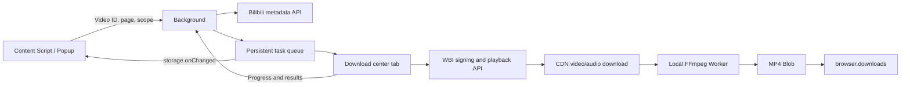

# Architecture

This document records the initial MP4 download architecture. Later custom part selection, quality caps, pause, P1 assets / file settings, P2 batch sources / cache / local helper, P3 sessions / history / task controls, P4 native integration, and P5 bundles are described in the [roadmap](roadmap.md) and [usage guide](usage.md). P1 added `comment.bilibili.com` access and Referer rules plus a user switch for existing optional notification permission. P4 added on-demand optional `nativeMessaging`. The initial permissions and video flow below are superseded by those later contracts where applicable.

The original implementation followed the default highest-available-quality, merged-MP4 design using the existing WXT, Vue 3, TypeScript, UnoCSS, and Manifest V3 stack. It builds directly as an extension without a local download service.

## Capability expansion: 2026-10-04

The [roadmap](roadmap.md) adds these features to the foundation below:

- Custom parts: `DownloadPartPicker` selects current / all / custom parts; the background validates page numbers and preserves metadata order.
- Quality: `DownloadQuality` and `useDownloadSettings` persist defaults; `DownloadJob.qualityPreference` stores the task snapshot, with `best` for legacy tasks. Requested qn follows preference. DASH filters by short-edge resolution; progressive validates explicit quality tiers and fails for unknown or excessive quality.
- Queue pause: `storage.local.downloadSettings.isPaused` gates `runner.claim`. Current work continues; new claims wait for resume. At this initial stage, pausing an individual transfer was not yet supported.
- Queue management: title/BV/part search, failure filtering, bulk retry with deduplication, and individual retry for cancelled tasks. Retry clears execution state and actual quality while retaining submitted preference.

Settings and queue mutations share a background lock. Partial updates merge only supplied fields, so pausing cannot reset quality. Interfaces subscribe to storage changes; task preferences do not change with defaults. This stage added no permissions or dependencies.

## Interaction and visual design

- Single videos display metadata and a button that immediately queues a download.
- Multi-part videos default to the current part; all-parts mode follows metadata order and saves separate MP4s.
- URL `p` selects the current part. BV/av or part changes reload metadata; stale requests cannot overwrite the new page.
- The download center shows queued, resolving, downloading, merging, saving, completed, failed, and cancelled states, with cancellation, bulk cancellation, retry, record cleanup, and open-folder actions.
- Files go under `Bilibili/` in the browser's default folder. The browser adds suffixes for duplicate names.

Colors are primary pink `#FB7299`, pale pink `#FFF1F5`, dark pink text `#BF3D66`, main text `#18191C`, secondary text `#70747C`, and page background `#F7F8FA`. Chinese fonts prefer PingFang SC / Microsoft YaHei. Content is left aligned and primary actions use full-width pink buttons with readable dark text. Shadow DOM isolates content-script styles.

```text
Video download                         Download center
Cover   Video title
        Creator / BV ID
Highest available quality              MP4
[ Current part ] [ All parts  3 ]   ← Multi-part only
P2 · Part title
[          Download current P2          ]
Automatic video/audio merge · Quality depends on account
Downloading media  1080P                   Cancel
━━━━━━━━━━━━━━━━━
```

## Runtime architecture



**A download center tab owns long-running work.** Chromium service workers may suspend, while a separate extension page can hold Workers, cached files, and Blobs and share its implementation with Firefox without Chrome-only offscreen APIs. First download opens a background tab without stealing focus. Keep it open; the original video page may close. Closing it interrupts work, which can be retried after reopening. Current media processing retains committed OPFS chunks and resumes after validation. Disk cache replaced the original complete-input memory download, and DASH, progressive, and AAC output now also goes to disk.

### Component and state boundaries

| File                                       | Responsibility / contract                                                                         |
| ------------------------------------------ | ------------------------------------------------------------------------------------------------- |
| `entrypoints/content/index.ts`             | Mount Shadow DOM after the video toolbar/player, track WXT URL changes, and clean up with context |
| `components/download/DownloadPanel.vue`    | Accept `url`; compose metadata, scope, primary action, and latest task                            |
| `components/download/DownloadProgress.vue` | Accept `job`; display stages/progress; emit `cancel(id)` and `retry(id)`                          |
| `components/download/DownloadQueue.vue`    | Display/filter the queue and handle queue actions                                                 |
| `composables/useVideoDownload.ts`          | Metadata requests, stale-response protection, current part, submission state                      |
| `composables/useDownloadQueue.ts`          | Subscribe to persistent tasks and wrap queue operations                                           |
| `entrypoints/downloads/App.vue`            | Download center layout and runner startup                                                         |

Background `storage.local.downloadJobs` is the single queue source; pages do not maintain independent Pinia queues. Local Vue state holds only scope, filters, loading, and errors.

## APIs and highest quality

### Video identification

Only `https://www.bilibili.com/video/BV...` or `av...` is accepted. `/x/web-interface/view` returns BV, title, cover, creator, and `pages`; `p` selects the exact CID. Missing parts fail explicitly; interactive videos are marked unsupported.

### Stream resolution

1. Request `/x/web-interface/nav` for the two `wbi_img` filenames. An unauthenticated `-101` containing signing material is usable.
2. Generate the 32-character key with the WBI permutation table and cache it for 30 seconds.
3. Sort parameters, filter `!'()*`, URL-encode, append `wts`, then MD5 the query plus key to produce `w_rid`.
4. Request `/x/player/wbi/playurl` with `qn=127`, `fnval=4048`, `fnver=0`, and `fourk=1`.
5. APIs use the existing browser session with 15-second timeouts, without reading, storing, or exporting cookies.

Implementation: `utils/bilibili/api.ts`, `wbi.ts`, and `streams.ts`. Zod validates API, message, and persisted-data boundaries.

### Selection strategy

`support_formats` provides display names, not download authorization. Selection considers only returned streams with supported CDN URLs:

1. Compare actual pixel resolution, then frame rate.
2. At equal resolution/frame rate, prefer SDR, then quality tier. SDR does not justify reducing resolution.
3. At equal quality, prefer AVC, then HEVC, then AV1; compare bitrate only afterward.
4. Choose highest-bitrate AAC. DASH without AAC fails rather than producing silent video.
5. `durl` fallback retains every segment and remuxes in order. Preview, DRM, or missing streams fail explicitly.

“Highest” means the best stream actually returned for the current account under this strategy, without promising unauthenticated 1080P / 4K. HEVC, AV1, and HDR playback depend on local compatibility.

These are internal site APIs; adaptations stay in those three modules. See the [yt-dlp Bilibili extractor](https://github.com/yt-dlp/yt-dlp/blob/master/yt_dlp/extractor/bilibili.py) for stream and signing reference.

## Queue, cancellation, and recovery

`DownloadJob` in `types/download.ts` contains BV, CID, part, title, state, progress, actual quality, bytes, and browser download ID. Temporary CDN URLs, cookies, and media bytes are not persisted in extension storage.

```text
queued → resolving → downloading → merging → saving → completed
   └────────── Any unfinished stage ─────────→ cancelled / failed
failed / cancelled → queued (user retry)
```

- A Promise lock serializes background mutations. Metadata loads before taking the lock, avoiding blocked cancellation.
- Initial deduplication uses `bvid + cid` for unfinished tasks; current-to-all adds only missing parts.
- Web Locks selects one download center executor across tabs.
- Each claim creates a fresh `runId`, rejecting delayed progress from previous runs.
- At most 1,000 tasks queue; the latest 100 terminal records remain. Clearing records does not delete disk files.
- `AbortController` stops reads, dedicated Worker termination stops remuxing, and cancellation while saving reaches the browser downloads API.
- Closing the center marks unfinished work failed; refreshing recovers processing tasks as failed and retains queued tasks.
- Expired URLs try alternate CDNs before one fresh resolution. Connections time out after 30 seconds without data; anti-abuse errors do not retry indefinitely.
- Valid Range responses with forward progress have no request-count cap. Invalid representations get at most one recovery attempt; strong ETags and cache checks determine safe resume.

## MP4 remuxing and resource cleanup

Common DASH MP4 video and standalone AAC are remuxed by Mediabunny in a dedicated Worker without decoding/re-encoding or requiring WebCodecs decoder support. Each input is a Blob of OPFS files read on demand, with a 4 MiB source read cache.

`remuxMedia` holds only the next encoded packet for each track and interleaves track heads by timestamp. Packets within each track retain decoding order, B-frame presentation timestamps, and audio/video offsets, avoiding the backlog caused by feeding an entire video first. Output uses fragmented MP4 / M4A (`fastStart: 'fragmented'`, minimum fragment duration two seconds) and `StreamTarget` writes positioned 1 MiB chunks to OPFS. A pinned Mediabunny patch releases written-fragment sample objects except the first sync sample and original index needed by final `tfra`; it also fixes flag compression for multiple keyframes per fragment. See the [patch notes](https://github.com/ntnyq/bilibili-downloader/blob/main/patches/README.md), [output formats](https://mediabunny.dev/guide/output-formats), and [output targets](https://mediabunny.dev/guide/writing-media-files).

Ordinary MP4 `moov` is traversed box by box, retaining sample-table file offsets. Track discovery skips sample indexes until the first packet request. `stts`, `ctts`, `stsz`, `stz2`, `stss`, `stsc`, `stco`, and `co64` remain in the source. Each track caches at most eight 16 KiB raw pages; the time, presentation-offset, and sample-to-chunk run tables each retain at most 128 prefix checkpoints and 256 decoded records. First-packet access scans run tables for checkpoints; sizes, chunk offsets, and sync samples are fetched on demand. Full arrays, cumulative sizes, and presentation-sorted copies are no longer expanded; PCM chunks are grouped on demand. Unknown/padding boxes are skipped without retaining the raw `moov`. Readers may coalesce or prefetch: 16 KiB is not an actual I/O or whole-task memory cap. Async box parsing is serial, and same-track initialization shares a Promise to prevent cross-request state corruption.

Those eight ordinary-MP4 tables no longer retain indexes proportional to sample count. Random access may rescan from checkpoints, and wide CTTS offset ranges can increase candidate scanning. Output indexes still grow with fragment count. Current-fragment media, fragmented-input lookup indexes, and encryption metadata retain their own memory cost; whole-task constant memory is not promised. Codec configuration, tags, and other leaf boxes still load per box, so an unusually large leaf can consume substantial memory. Very long GOPs also extend current-fragment buffering. Some older players/editors handle fMP4 less well than ordinary MP4.

Media tasks have no fixed 16 GiB cap. `StorageManager.estimate()` gives origin `quota` and `usage`; checks reserve missing input, expected output at 105% of input, and 64 MiB safety margin. Cached bytes are already in `usage` and are not reserved again; completed tracks still count toward output. Checks run after response lengths/cache revalidation and before chunk writes. Estimates refresh every 8 MiB or one second, immediately near budget boundaries or representation resets, and once again before remuxing. Unknown lengths use actual growth; bitrate estimates no longer reject tasks. See [StorageManager.estimate](https://developer.mozilla.org/en-US/docs/Web/API/StorageManager/estimate).

Indicative fresh input capacity is `(quota - usage - 64 MiB) / 2.05`; resuming removes duplicate input reservation. The 105% and 64 MiB values are project margins, not browser limits. Quota estimates are not physical free space. If estimates are unavailable or fail, streaming continues and real OPFS write errors remain authoritative. The final Downloads copy needs additional disk space outside origin quota.

Cache manifest v2 run-length encodes consecutive equal-sized 1 MiB chunks. Typical long media needs one full-chunk count plus a tail, removing the former 16,384-file limit. v1 remains readable and converts on the next commit without changing paths or committed bytes. A 1 MiB manifest limit, 16,384 distinct size groups, and safe-integer checks bound malformed metadata and extreme fragmentation without imposing a fixed byte limit on normal streams.

Cache-panel polling reads/validates manifest metadata and counts committed bytes without opening every media chunk. Recovery still validates every chunk's existence/size, and input-Blob creation checks again. Usage reporting is not an integrity check: corrupt cache can briefly appear in totals before reuse fails.

Remux output lives under cache-root `merged-output`, separate from resumable-input counts. Successful remuxing returns a disk `File` snapshot without full-output `arrayBuffer` or FFmpeg `readFile`. `saveFile` passes a Blob URL to downloads and retains output until saving ends; failure/cancellation also clears output. Workers must acknowledge startup within 120 seconds. Afterward neither missing byte progress nor elapsed time alone fails them: index parsing, final indexes, and synchronous WASM work can have long quiet periods. Pause/cancel terminates the Worker; real Worker and I/O errors propagate. Outputs left by tab closure are removed during later cleanup; failed/paused inputs preserve their resume semantics.

Legacy progressive FLV / MP4 still uses bundled single-threaded `@ffmpeg/core` for parsing/concatenation. Inputs mount read-only through WORKERFS. `ffmpegDiskFile` replaces Emscripten operations for one ordinary output: read/write, truncate, and allocate go directly to the Worker's OPFS `FileSystemSyncAccessHandle`, with large-offset seeking. It does not inherit MEMFS media writes, expansion, or mmap. Short writes loop; quota/I/O errors remain visible and fail the task rather than publishing truncated output. See [synchronous disk access](https://developer.mozilla.org/en-US/docs/Web/API/FileSystemFileHandle/createSyncAccessHandle) and the [Emscripten filesystem](https://emscripten.org/docs/api_reference/Filesystem-API.html).

Segments use FFmpeg's concat demuxer and `-c copy`. Output enables `frag_keyframe`, two-second `frag_duration`, `empty_moov`, `delay_moov`, `default_base_moof`, and `negative_cts_offsets`, releasing sample tables per fragment. `delay_moov` preserves initialization timing offsets and AAC sync. MEMFS holds only the tiny concat list; WASM still needs input indexes and work buffers, with a 2 GiB core heap ceiling. Memory is therefore not strictly constant. Progressive shares dynamic disk budgeting; the old 512 MiB and full-output `readFile` paths are removed. Core `setTimeout(-1)` removes the fixed 30-minute limit; terminating its dedicated Worker handles cancellation. See [FFmpeg MOV/MP4 fragmentation options](https://ffmpeg.org/ffmpeg-formats.html#mov_002c-mp4_002c-ismv).

WXT copies only the single-threaded FFmpeg core JS/WASM; the unused `@ffmpeg/ffmpeg` package and wrapper Worker were removed. DASH / AAC uses Mediabunny. Both paths share quota checks, output saving, and orphan cleanup without remote scripts or extra extension permissions.

## Extension permissions

| Permission                               | Purpose                                                    |
| ---------------------------------------- | ---------------------------------------------------------- |
| `storage`                                | Queue, progress, bounded history, download-center identity |
| `activeTab` / `tabs`                     | Identify popup tab, reuse download center, detect closure  |
| `downloads`                              | Save MP4, detect completion, cancel, open folder           |
| `declarativeNetRequestWithHostAccess`    | Set Referer on extension-owned Bilibili API / CDN requests |
| Bilibili page/API and selected CDN hosts | Inject UI and fetch cross-origin metadata/media            |

Referer rules require extension `initiatorDomains`, API/CDN `requestDomains`, and XHR/fetch type. They do not alter the site player or other-site requests. CSP adds only `wasm-unsafe-eval` for local WebAssembly. See [Chrome DNR](https://developer.chrome.com/docs/extensions/reference/api/declarativeNetRequest) and [Firefox RuleCondition](https://developer.mozilla.org/en-US/docs/Mozilla/Add-ons/WebExtensions/API/declarativeNetRequest/RuleCondition).

## Verification and future work

Unit tests use existing `tsx` and Node's test runner via `pnpm test`. Coverage includes fixed WBI vectors, encoding filters, actual highest quality, AAC, alternate URLs, segment completeness, part identification, queue deduplication, filenames, cancellation, and size limits. CI also runs formatting, lint, types, and Chromium / Firefox builds.

Browser checks cover one-click downloads, current/all parts, SPA navigation, duplicate clicks, real MP4 tracks, cancellation/retry, refresh/closure, failures, unknown lengths, and competing windows. See [verification records](verification.md).

The original architecture left seams for persisted quality preferences, OPFS/resume, and local FFmpeg via Native Messaging without changing the panel or core state contract; these features are now tracked in the roadmap.
