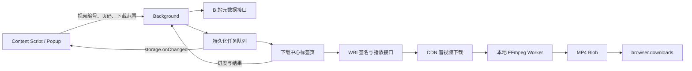

# B 站下载器：实现方案

::: info 架构与历史
本页说明模块边界，并保留分阶段实现背景。当前用户行为见[功能指南](usage.md)，最新浏览器磁盘封装与容量说明见[缓存与大型下载](cache-storage.md)。历史阶段的固定容量限制不代表当前限制。
:::

本文记录最初的 MP4 下载架构。后续的分 P 自选、画质上限、暂停、P1 素材导出 / 文件设置、P2 批量来源 / 下载缓存 / 本地助手、P3 会话恢复 / 长期历史 / 单任务控制、P4 原生助手集成及 P5 素材组合，详见 [扩展路线图](roadmap.md) 和 [使用说明](usage.md)。P1 新增弹幕主机 `comment.bilibili.com` 的访问及 Referer 规则，并启用既有可选通知权限的用户开关；P4 新增按需申请的可选 `nativeMessaging` 权限。下文仅列初版权限与视频流程，后续契约以路线图为准。

本实现基于讨论中的「默认最高可用画质、音视频合并 MP4」方案，沿用项目已有的 WXT、Vue 3、TypeScript、UnoCSS 和 Manifest V3。新增代码可以直接构建为扩展，不依赖本地下载服务。

## 2026-10-04 能力扩展

本轮计划见 [扩展路线图](roadmap.md)。在以下基础架构上增加：

- 自选分 P：`DownloadPartPicker` 提供当前 / 全部 / 自选范围，后台校验页码并按元数据顺序入队。
- 画质偏好：`DownloadQuality` 与 `useDownloadSettings` 持久化默认值；`DownloadJob.qualityPreference` 保存任务快照，旧任务默认 `best`。请求 qn 随偏好变化，DASH 按短边分辨率过滤上限，progressive 按明确画质档位校验，未知或高于上限时失败。
- 队列暂停：`storage.local.downloadSettings.isPaused` 控制后台 `runner.claim`。当前任务继续执行，恢复后才领取下一项；仍不支持下载途中断点暂停。
- 队列整理：搜索标题、BV 和分 P；筛选失败；批量重试失败并去重，取消任务仅单独重试。重试清除旧执行状态和实际画质，但保留提交偏好。

设置与队列修改共用后台锁，设置更新只合并提供的字段，避免暂停操作重置画质。各界面订阅 storage 变化；任务偏好不随默认设置变化。无新增权限或依赖。

## 交互与视觉

- 单视频：展示视频信息与「下载视频」按钮，点击后直接加入队列。
- 多 P：默认「当前分 P」，切换到「全部分 P」后按视频信息接口返回的顺序下载；每个分 P 保存独立 MP4，不拼接成一个长视频。
- 页面 URL 的 `p` 决定当前分 P；切换 BV / av 或分 P 后重新获取元数据，旧请求的结果不会覆盖新页面。
- 下载中心展示等待、解析、下载、合并、保存、完成、失败、取消状态，支持取消、批量取消、失败重试、清除记录和打开文件夹。
- 下载目录是浏览器默认下载目录下的 `Bilibili/`，重名文件由浏览器自动增加后缀。

视觉使用 `#FB7299` 主粉色、`#FFF1F5` 浅粉、`#BF3D66` 深粉文字、`#18191C` 主文字、`#70747C` 次要文字和 `#F7F8FA` 页面底色。中文字体优先 PingFang SC / Microsoft YaHei，主内容左对齐，主要操作使用整行粉色按钮。深色按钮文字保证在浅粉背景上的可读性。内容脚本通过 Shadow DOM 隔离站点样式。

```text
视频下载                              下载中心
封面    视频标题
        UP 主 / BV 号
最高可用画质                         MP4
[ 当前分 P ] [ 全部分 P  3 ]   ← 仅多 P 显示
P2 · 分 P 标题
[             下载当前 P2             ]
自动合并音视频 · 画质取决于当前账号权限
下载音视频  1080P 高清                    取消
━━━━━━━━━━━━━━━━━
```

## 运行架构



**本版采用下载中心标签页承担长任务。** Chromium 的 service worker 随时可能挂起；独立扩展页面可以持有 Worker、缓存文件和 Blob，并与 Firefox 共用实现，无需 Chrome 专属的 offscreen API。首次点击下载会创建不抢焦点的后台标签页。用户需要保持下载中心打开，可以关闭原视频页面；关闭下载中心会中断任务，重新打开后可以重试。当前音视频流程会保留 OPFS 已提交的块，并在重试校验通过后续传；下面最初流程中的全量输入内存下载已由磁盘缓存替代；DASH、progressive 和 AAC 的输出也已改为磁盘封装。

### 组件与状态边界

| 文件                                       | 单一职责 / 契约                                                              |
| ------------------------------------------ | ---------------------------------------------------------------------------- |
| `entrypoints/content/index.ts`             | 在视频工具栏或播放器之后自动挂载 Shadow DOM，监听 WXT 地址变化，随上下文清理 |
| `components/download/DownloadPanel.vue`    | 接收 `url`，组合视频信息、下载范围、主按钮与最新任务                         |
| `components/download/DownloadProgress.vue` | 接收 `job`，展示阶段与进度，发出 `cancel(id)`、`retry(id)`                   |
| `components/download/DownloadQueue.vue`    | 展示与筛选队列，处理队列级用户操作                                           |
| `composables/useVideoDownload.ts`          | 元数据请求、过期响应保护、当前分 P 与提交状态                                |
| `composables/useDownloadQueue.ts`          | 监听持久化任务变化并封装队列操作                                             |
| `entrypoints/downloads/App.vue`            | 下载中心页面布局与 runner 启动                                               |

状态以后台 `storage.local.downloadJobs` 为唯一来源，不使用各页面独立的 Pinia 队列。Vue 的本地状态只保留下载范围、筛选项、加载状态和错误信息。

## 接口与最高画质

### 识别视频

只接受 `https://www.bilibili.com/video/BV...` 或 `av...`。调用 `/x/web-interface/view` 获取 BV、标题、封面、UP 主和 `pages` 列表，按 `p` 精确匹配 CID。不存在的分 P 直接报错，互动视频明确标记为暂不支持。

### 获取播放流

1. 请求 `/x/web-interface/nav` 获取 `wbi_img` 的两个文件名；未登录但携带签名材料的 `-101` 响应可以使用。
2. 按 WBI 混排表生成 32 字符密钥，缓存 30 秒。
3. 对参数排序、过滤 `!'()*`、URL 编码，附加 `wts`，对查询串与密钥计算 MD5 得到 `w_rid`。
4. 请求 `/x/player/wbi/playurl`，参数包含 `qn=127`、`fnval=4048`、`fnver=0`、`fourk=1`。
5. 所有接口使用浏览器现有登录状态，API 请求超时 15 秒；不读取、保存或导出 Cookie。

相关代码：`utils/bilibili/api.ts`、`wbi.ts`、`streams.ts`。Zod 在 API、消息和持久化数据边界校验结构。

### 选择策略

`support_formats` 只用于显示名称，不被视为下载权限。选择只依据真实返回、有受支持 CDN 地址的视频流：

1. 优先比较实际分辨率像素数，然后比较帧率。
2. 同分辨率和帧率下优先 SDR，然后比较画质档位；不会为了 SDR 自动降为更低分辨率。
3. 同画质优先 AVC，再 HEVC，最后 AV1；仅在这些条件相同后比较码率。
4. 音频选择最高码率 AAC。DASH 缺少 AAC 时提示错误，避免生成没有声音的视频。
5. `durl` 回退保留全部片段并按顺序重新封装；试看、DRM 和无流响应明确失败。

“最高”指此选择策略下当前账号实际返回的最高可用流，不承诺未登录也能获取 1080P / 4K。HEVC、AV1 或 HDR 输出仍取决于本地播放器兼容性。

接口属于站点内部接口，后续变动集中在这三个模块中适配。[取流与签名实现参考：yt-dlp](https://github.com/yt-dlp/yt-dlp/blob/master/yt_dlp/extractor/bilibili.py)。

## 队列、取消和恢复

`DownloadJob` 定义在 `types/download.ts`，包含 BV、CID、分 P、标题、状态、进度、实际画质、字节数和浏览器下载 ID。临时 CDN URL、Cookie 和视频二进制不写入持久化存储。

```text
queued → resolving → downloading → merging → saving → completed
   └──────────── 任意未完成阶段 ─────────────→ cancelled / failed
failed / cancelled → queued（用户重试）
```

- 后台用 Promise 锁序列化读写，先完成元数据请求再持有锁，避免阻塞取消。
- 按 `bvid + cid` 去重未完成任务；从「当前」切到「全部」只补充未入队的分 P。
- 使用 Web Locks 选出一个下载中心执行队列，即使用户手动打开多个下载中心也不会并行合并。
- 每次领取任务生成新的 `runId`，防止上一次执行的延迟进度覆盖已经重试的任务。
- 最多排队 1000 个任务，保留最近 100 条终态记录；清除记录不会删除磁盘文件。
- `AbortController` 取消网络读取，终止专用 Worker 取消合并，保存中取消会通知浏览器下载 API。
- 关闭下载中心会把未完成任务标为失败；刷新时恢复处理中任务为失败，并保留排队项。
- 下载地址过期：先尝试备用 CDN，所有线路失败后重新获取一次播放地址。每条连接连续 30 秒无数据则超时；不会无限重试风控错误。
- 有效 Range 响应持续向前时不限制请求次数；无效表示最多恢复一次，避免无进展循环。强 ETag 和缓存校验决定是否可安全续传。

## MP4 合并与资源释放

常见 DASH MP4 视频与独立 AAC 音轨使用 Mediabunny 在专用 Worker 中无损封装，不解码、不重新编码，也不要求设备支持对应 WebCodecs 解码器。每个输入由 OPFS 文件组成的 Blob 提供，按需读取，单源读取缓存为 4 MiB。

`remuxMedia` 只保留各轨道的下一个编码数据包，按轨道头部时间戳交错供给输出；每条轨道内部始终遵循解码顺序，保留 B 帧的显示时间戳和音视频偏移，避免先喂完整视频导致大量音频或视频积压。输出使用分片 MP4 / M4A（`fastStart: 'fragmented'`，最小片段时长 2 秒），媒体数据按 1 MiB 块经 `StreamTarget` 定位写入 OPFS。固定版本的 Mediabunny 补丁在每个片段完成时，把每轨道的 28 字节 TFRA 记录追加到 OPFS 临时文件，等待写入背压后释放整个已写 chunk 和样本。每轨道只有一个 64 KiB 写缓冲；收尾先提交索引写流，再以最多 64 KiB 的页流式写出 `mfra` / `tfra` / `mfro`，每页刷新输出。muxer 只保留计数，不构造完整索引数组或最终 box 树，并检查 MFRO 的 32 位包围尺寸上限。补丁同时修复同片段多个关键帧的标记压缩。详见 `patches/README.md`。[Mediabunny 输出格式](https://mediabunny.dev/guide/output-formats)、[输出目标](https://mediabunny.dev/guide/writing-media-files)。

输入普通 MP4 的 `moov` 改为按 box 遍历，仅保留样本表的文件偏移；发现轨道时跳过样本索引，首次请求该轨道的数据包时才解析。`stts`、`ctts`、`stsz`、`stz2`、`stss`、`stsc`、`stco` 与 `co64` 保留在输入源上，每轨道最多缓存 8 个 16 KiB 原始页；时间 / 显示偏移 / sample→chunk 三张游程表各最多保留 128 个前缀检查点和 256 条解码记录。首次数据包扫描游程表建立检查点，样本大小、chunk 偏移与同步样本按需读取；不再展开完整数组、累计大小或显示时间排序副本，PCM 也按需合并 chunk。未知 / 填充 box 跳过内容，不再整块读取或常驻原始 `moov`。读取器可能合并相邻读取或预读，16 KiB 不是实际 I/O 或任务总内存上限。异步 box 解析串行执行，同轨道共享初始化 Promise，避免并发查找污染当前轨道状态。

输入 fMP4 的 `mfra` 同样按范围遍历；发现轨道时只读 `tfra` 头部，每轨道最多保留 4 个复制的 16 KiB 索引页。首次索引访问流式校验顺序；有序表按二分查找，乱序表流式回退，不展开排序副本。每轨道的位置提示和累计解码时间锚点分别最多保留 128 条，全局片段摘要最多保留 128 条；淘汰后按需回读或重扫前缀。缺少 `tfdt` 时，通过精确的 TFRA 样本引用或连续累计解码时间恢复基准，不能把显示时间终点当作解码时间终点。片段解析、时间恢复和缓存发布共用串行锁，避免并发轨道或读取失败发布不完整片段。独立 init input 的片段文件遵循相同边界。

输入单个 `moof/traf` 也按文件范围遍历，`trun` 样本行保留在源文件。每轨道片段最多缓存 4 个复制的 16 KiB 页、128 个自适应摘要、256 条原始样本和 512 条计算时长，不保留样本 / run 计数 / 排序时间戳数组。首次访问流式构建摘要；默认值 run 用算术累计。单调 PTS 二分查找，重排 PTS 按摘要筛选并重扫，时长在固定 256 样本窗口计算，保留重复时间戳的稳定顺序。缺少 TFDT 时仍按精确 TFRA run / sample 引用恢复。片段内 `senc` 和 `saiz/saio` 仅记录位置，按包解析 IV / 子样本，变长辅助信息最多保留 128 个检查点。读取失败可重试，取消继续传播。

当前片段载荷和固定 56 字节样本描述改用可定位读写的磁盘暂存。每轨道保留两个 56 KiB 描述页、一个 64 KiB 媒体写页和固定 32 KiB 时间戳游程缓冲；小 GOP 在固定缓冲内排序，大 GOP 通过两个复用文件分轮归并，输入 / 输出页最多 64 KiB。排队位置和 GOP 范围只用标量游标。muxer 扫描描述记录选择默认值与标记，再分页写出 `moof` / `trun` 头和条目，不展开完整样本数组、排序时间戳数组或 box 树。重复时间、B 帧、零时长、起始偏移、关键帧引用、扩展 MDAT 尺寸和 TFHD 绝对基址均与原输出逐字节一致。

已完成的描述 / 媒体前缀按页压缩，保留排队尾部，每轨道复用四个文件。专用 Worker 使用 [OPFS 同步访问句柄](https://developer.mozilla.org/en-US/docs/Web/API/FileSystemFileHandle/createSyncAccessHandle)进行定位更新，不支持时明确失败，不回退到全量内存。完成或报错前关闭句柄，取消时终止 Worker 并删除整个任务目录。排序仍需要随 GOP 增长的磁盘空间与 I/O，轨道极度失衡时前缀压缩也会增加工作量。

普通 MP4 的上述八张样本表保留内存不随样本数线性增长，代价是随机访问可能从检查点重扫；极宽的 CTTS 显示偏移范围也可能增加候选样本扫描量。应用的输出索引保留内存同样有界，临时磁盘占用按每轨道每条有效片段记录 28 字节增长。每次封装使用独立任务目录，包含输出和轨道索引，保存完成、失败或取消后一起删除；索引写流在报告完成前关闭，Worker 终止留下的短暂 OPFS 锁会在清理时重试。输出 GOP 描述、时间戳排序及 moof/trun 生成的保留内存不再随样本数线性增长；输入单个 moof 的样本元数据也有固定缓存上限，但首次扫描与重排时间戳查找仍可能增加 I/O / CPU。单个调用方 / 排队数据包及其 backing buffer、输入源缓存、单包加密信息和普通 MP4 的加密辅助表仍有开销，因此不承诺整个任务恒定内存。编解码配置、标签等其他叶子 box 仍按 box 读取，异常巨大的单个叶子 box 仍可能占用较多内存。超长 GOP 会增加临时媒体磁盘占用；排队 / 当前媒体、描述文件、排序文件及原子写入临时空间与输出共存，预估余量不保证覆盖该额外空间，真实配额错误会终止并清理任务目录。分片 MP4 在部分旧播放器和编辑器中的兼容性低于普通 MP4。

音视频任务不再设固定 16 GiB 上限。`StorageManager.estimate()` 提供当前 origin 的 `quota` 和 `usage`；下载时为尚未缓存的输入、预计封装输出（输入的 105%）与 64 MiB 安全余量检查空间。已缓存数据已计入 `usage`，不会再次算作缺失输入；已完成轨道仍计入输出大小。检查在媒体响应长度 / 缓存重验后、写块前执行，每 8 MiB 增量或 1 秒刷新估算，接近预算边缘及表示重置时立即刷新。没有长度的响应按实际增长计算，码率估算不再用来拒绝任务。封装前再取一次最新估算。[StorageManager.estimate](https://developer.mozilla.org/en-US/docs/Web/API/StorageManager/estimate)。

全新下载的输入参考容量约为 `(quota - usage - 64 MiB) / 2.05`；续传会扣除已缓存输入的重复预留。105% 与 64 MiB 是项目的封装开销 / 估算余量策略，不是浏览器硬限制，也不保证覆盖极端碎片化输入；临时输出索引同样消耗配额。API 返回的是配额估算，并非系统实际剩余磁盘空间；若估算缺失或失败，仍按流写入并由真实 OPFS 写入报错处理。最终 Downloads 副本在 origin 配额之外，还需额外磁盘空间。

缓存清单 v2 对连续同尺寸的 1 MiB 文件块进行游程压缩，正常长视频的清单只有一个完整块计数和尾块，不再受旧的 16384 文件块限制。v1 清单仍可读取，后续提交转换为 v2，文件路径和已提交数据保持不变。保留 1 MiB 清单 / 16384 个不同尺寸组的元数据边界与安全整数校验，用于限制损坏数据和极端碎片；这些约束不为正常连续流设置固定媒体字节上限。

缓存面板轮询只读取并验证清单元数据，统计已提交字节，不逐块打开媒体文件。恢复缓存时仍完整验证每个块的存在与大小，创建输入 Blob 时再次检查；统计不是完整性检查，损坏缓存可能在复用前短暂计入用量。

封装输出位于下载缓存根目录下的 `merged-output`，不会计入可续传素材数量。成功封装后只获取磁盘 `File` 快照，不调用完整输出的 `arrayBuffer` 或 FFmpeg `readFile`。`saveFile` 通过 Blob URL 交给浏览器下载 API，等保存结束再删除 OPFS 输出；保存失败或取消也会清理输出。Worker 必须在 120 秒内确认启动，确认后不以字节进度或总耗时判断失败：解析索引、最终写入索引及同步 WASM 工作期间可能长时间没有进度。用户仍可取消 / 暂停并终止 Worker，实际 Worker 错误、I/O 错误正常上报。页面关闭留下的输出会在下一次缓存清理中移除；失败或暂停任务的输入缓存保持原有续传语义。

旧格式 progressive FLV / MP4 继续由浏览器内的单线程 `@ffmpeg/core` 解析和拼接。输入通过 WORKERFS 只读挂载，`ffmpegDiskFile` 为一个普通输出文件替换 Emscripten 文件操作：读写和 truncate / allocate 直接交给 Worker 内的 OPFS `FileSystemSyncAccessHandle`，定位操作支持大文件偏移；不继承 MEMFS 的媒体写入、内存扩容或 mmap。短写循环补全，原始配额 / I/O 错误保留并使任务失败，避免把截断文件标为成功。[同步磁盘接口](https://developer.mozilla.org/en-US/docs/Web/API/FileSystemFileHandle/createSyncAccessHandle)、[Emscripten 文件系统](https://emscripten.org/docs/api_reference/Filesystem-API.html)。

分段仍使用 FFmpeg concat demuxer，`-c copy` 不重新编码。输出启用 `frag_keyframe`、2 秒 `frag_duration`、`empty_moov`、`delay_moov`、`default_base_moof` 与 `negative_cts_offsets`，按片段释放输出样本表；`delay_moov` 保留初始化所需的时间偏移，避免 AAC 起始时间偏移改变音画同步。MEMFS 只保存很小的拼接清单，WASM 仍需要输入容器索引和工作缓冲，核心堆上限为 2 GiB，因此内存并非严格恒定。progressive 同样使用动态磁盘预算，旧 512 MiB 限制及完整输出 `readFile` 路径已移除。FFmpeg 核心设置 `setTimeout(-1)` 取消固定 30 分钟时限，由终止专用 Worker 响应用户取消。[FFmpeg 分片与 MOV/MP4 选项](https://ffmpeg.org/ffmpeg-formats.html#mov_002c-mp4_002c-ismv)。

WXT 只复制单线程 FFmpeg 核心 JS / WASM，移除了不再使用的 `@ffmpeg/ffmpeg` 包和包装 Worker。DASH / AAC 仍走 Mediabunny；两条路径共享磁盘配额检查、输出保存生命周期与残留清理，不执行远程脚本、不添加扩展权限。

## 扩展权限

| 权限                                      | 用途                                         |
| ----------------------------------------- | -------------------------------------------- |
| `storage`                                 | 队列、进度、有限历史和下载中心标识           |
| `activeTab` / `tabs`                      | 读取弹窗对应页面、复用下载中心、检测标签关闭 |
| `downloads`                               | 保存 MP4、检查完成状态、取消、打开文件夹     |
| `declarativeNetRequestWithHostAccess`     | 给扩展自身的 B 站 API / CDN 请求设置 Referer |
| B 站页面、API 和指定 CDN host permissions | 注入界面、跨域元数据与媒体下载               |

Referer 规则同时限定 `initiatorDomains` 为本扩展、`requestDomains` 为 API/CDN 域名、类型为 XHR/fetch，不修改网站播放器或其他网站请求。CSP 仅添加本地 WebAssembly 必需的 `wasm-unsafe-eval`。[Chrome DNR](https://developer.chrome.com/docs/extensions/reference/api/declarativeNetRequest)、[Firefox RuleCondition](https://developer.mozilla.org/en-US/docs/Mozilla/Add-ons/WebExtensions/API/declarativeNetRequest/RuleCondition)。

## 验证与后续扩展

单元测试使用现有 `tsx` 与 Node 内置测试器，运行 `pnpm test`。覆盖 WBI 固定样例、过滤编码、最高实际画质、AAC、备用地址、分片完整性、分 P 识别、队列去重、文件名和取消/大小限制。CI 同时执行测试、格式、lint、类型和 Chromium / Firefox 构建。

浏览器验证应覆盖：单视频一键下载、多 P 当前/全部切换、SPA 地址变化、重复点击、真实 MP4 音视频轨、取消/重试、刷新/关闭下载中心、失败响应、无内容长度和多窗口竞争。验证记录见 `verification.md`。

进一步扩展可独立加入用户画质偏好、OPFS 缓存与断点续传，或用 native messaging 调用本地 FFmpeg 处理大视频；都不需要改动下载面板与任务状态的核心契约。
